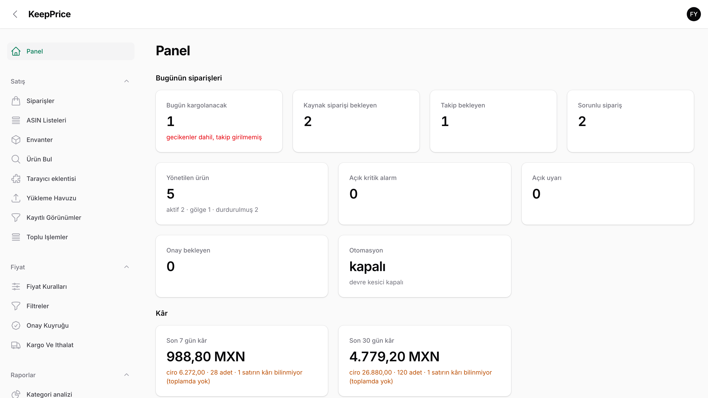
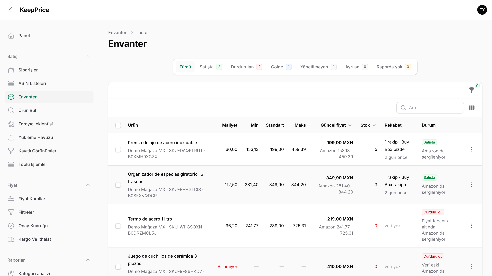
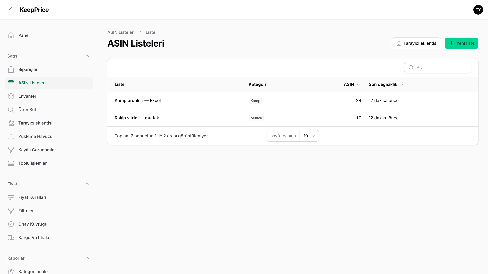
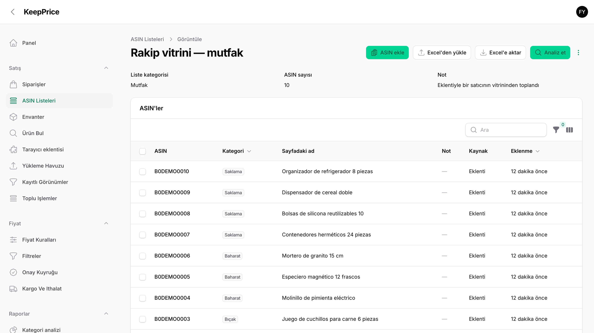
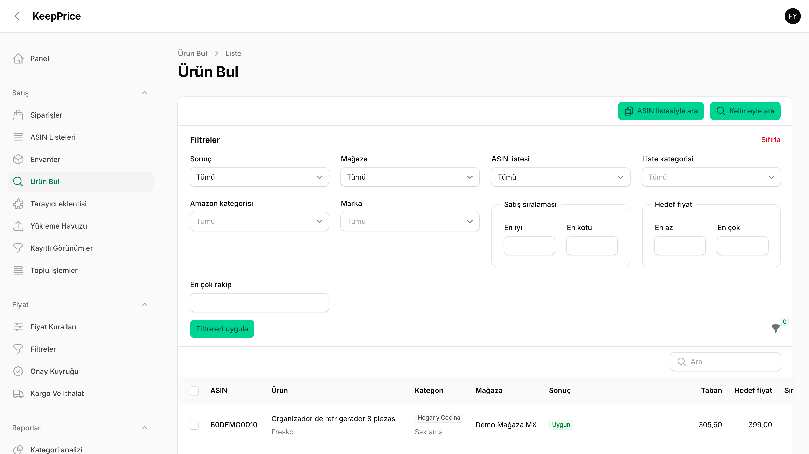
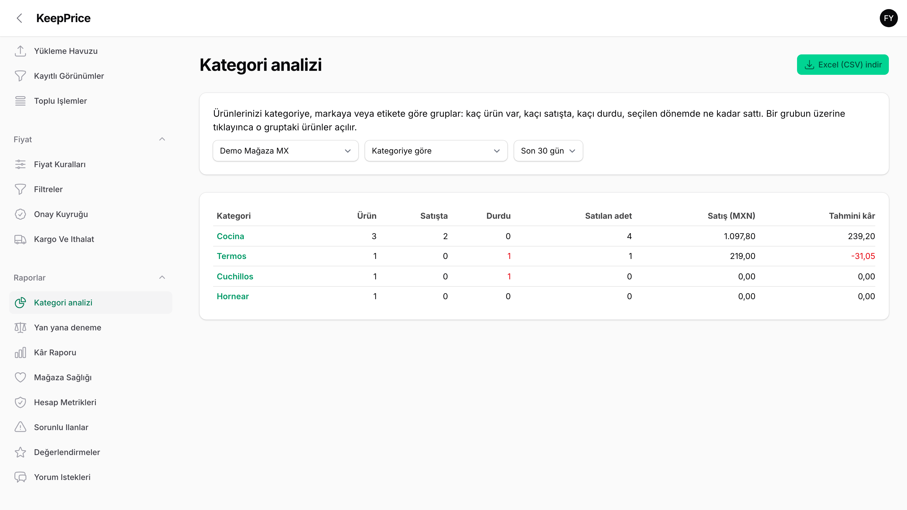
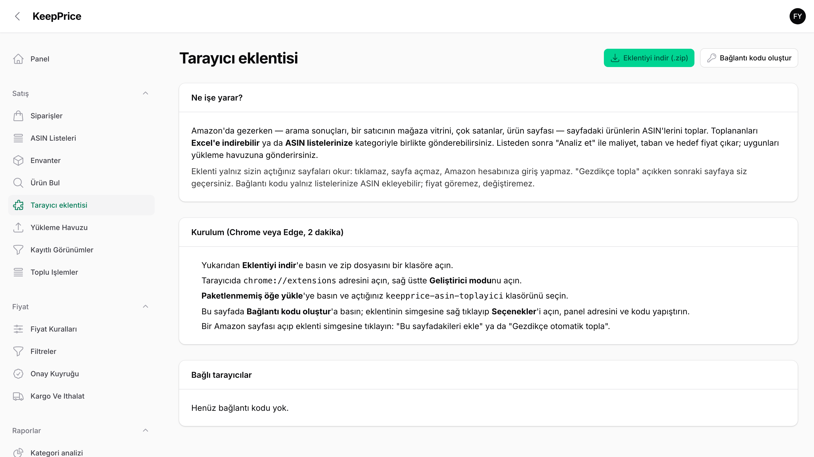
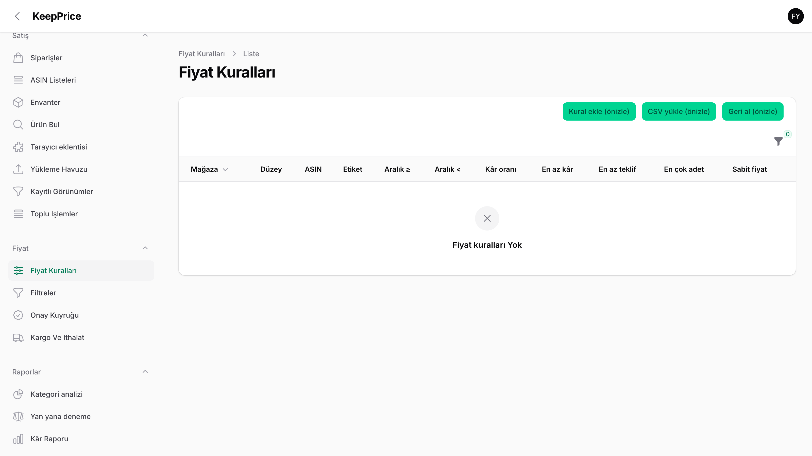
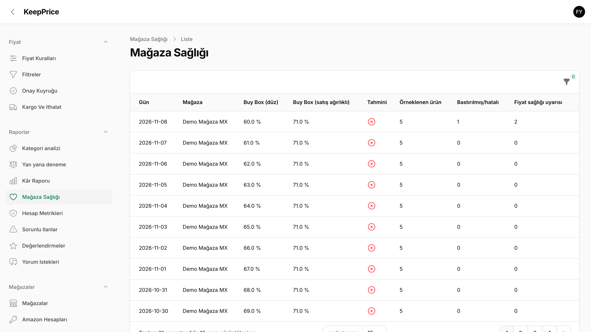
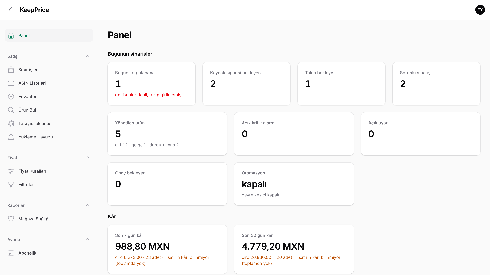

# KeepPrice

**Amazon satıcıları için envanter, fiyat ve sipariş paneli.**

> Bu depo yalnızca bir **vitrindir**. Ürünün kaynak kodu burada yoktur ve paylaşılmaz.
> Görseller ve metinler tescillidir; kullanım koşulları için [LICENSE](LICENSE) dosyasına bakın.

Ekranlardaki tüm mağaza, ürün ve sipariş bilgileri **demo veridir**; gerçek müşteri bilgisi içermez.

## Ne yapar?

| | |
|---|---|
| **Fiyat güvenliği** | Ana ilke: şüphe varsa satışı durdurur, fiyatı asla maliyetin altına düşürmez. |
| **Envanter** | Tüm mağazalardaki ürünler tek tabloda: maliyet, taban, hedef fiyat, stok, rekabet, durum. |
| **ASIN listeleri** | İstediğiniz ürünleri kendi kategorilerinizle saklayın; Excel'den yükleyin, Excel'e alın. |
| **Ürün bul** | Listeleri maliyet, taban ve hedef fiyattan geçirir; uygunları kontrollü yükleme havuzuna gönderir. |
| **Tarayıcı eklentisi** | Açtığınız Amazon sayfasındaki ürünleri toplar; Excel'e indirir ya da listeye gönderir. |
| **Filtreler ve analiz** | Marka, kategori, etiket, fiyat, sıralama, stok; kategori / marka bazında rapor. |
| **Siparişler** | Günün kargoları, bekleyen kaynak siparişleri, sorunlu siparişler. |
| **Basit mod** | İsteyene yalnız her gün kullanılan ekranları gösteren sade menü. |

## Videolar

Her özellik için 20–35 saniyelik kısa anlatımlar:
**[Nasıl kullanılır videoları (Google Drive)](https://drive.google.com/drive/folders/18V0dIXcpE2Lt82sPqewpDTBQhffcILwA)**

## Ekranlar

**Panel — günün özeti**

**Envanter**

**ASIN listeleri**

**Liste içeriği ve kategoriler**

**Ürün bul — filtreler**

**Kategori analizi**

**Tarayıcı eklentisi**

**Fiyat kuralları**

**Mağaza sağlığı**

**Basit mod**

---

© 2026 Başar Tuncay. Tüm hakları saklıdır. Kopyalanamaz, çoğaltılamaz, yeniden kullanılamaz.
